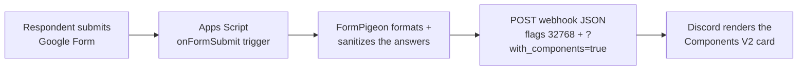

<div align="center">

# 🕊️ FormPigeon

**Google Forms → Discord notifications, rebuilt on [Components V2](https://docs.discord.com/developers/components/reference).**

A single-file Google Apps Script that posts every new form response to your
Discord channel as one clean, colorful card — no servers, no dependencies,
no polling, no cost.


</div>

---

## Why another Forms-to-Discord script?

Most existing scripts either require you to host a bot, or bolt Google Forms
onto **legacy embeds**. FormPigeon is a from-scratch take designed around what
Discord actually renders in 2025+:

| | FormPigeon | Typical legacy script |
|---|---|---|
| Message format | **Components V2 card** (`Container` + `Text Display`) | Embeds / plain text |
| Hosting | Google Apps Script, bound to the form | Often a VPS or bot account |
| Setup | Menu inside the form editor | Manually editing triggers |
| Long answers | **Auto-paginates** into multiple cards | Truncated or fails silently |
| Edited responses | Detected and labeled **📝 Edited** | Not detected |
| Respondent markdown | **Sanitized** — nobody can forge headings, spoilers or pings | Injected verbatim |
| File uploads | Real file names via Drive, optional image gallery | Raw IDs or ignored |
| Pings | `allowed_mentions` allow-list — **answers can never ping @everyone** | Up to chance |

## Features

- **Components V2 single card** — `Container` with accent stripe, header
  section with icon, separators, one `Text Display` per question, footer with
  links. This is the embed-replacement format Discord is pushing.
- **Automatic pagination** — Discord allows 4,000 characters of text and 40
  components per message; FormPigeon splits long submissions into
  `Part 2 of 3` cards automatically.
- **Edit detection** — when a respondent edits and re-submits their answer
  (forms with "Allow response editing"), the new notification is labeled
  **Edited response** instead of **New response**.
- **File uploads** — Drive file IDs become proper links with **real file
  names** resolved through Drive, or an image **Media Gallery** if you make the
  files public.
- **Mentions done right** — optional role/user/`@everyone` ping prepended to
  each notification; `allowed_mentions` guarantees respondent answers can never
  ping anyone.
- **Multiple webhooks** — send the same card to several servers/channels.
- **Forum & thread support** — optionally post into a specific thread or
  forum post via `thread_id`.
- **Markdown sanitization** — `**bold**`, `||spoiler||`, fake headings and
  forged mentions typed by respondents render as harmless plain text.
- **One-click test** — the 🕊️ Discord menu sends a preview card so you can
  verify everything before going live.
- **Failure alerts** — if Discord rejects a post (deleted webhook, quota…),
  the script emails you instead of failing silently.

## How it works



Everything runs inside Google's infrastructure the moment a response arrives.
There is nothing to host, and the webhook URL never leaves your script.

## What a notification looks like

```text
╭───────────────────────────────────────────────┐
│ 📬  New response — 2026 Community Survey   ⊞  │   ← Container (type 17)
│ ───────────────────────────────────────────── │     accent stripe on the left
│                                               │
│ 1. Full name                                  │   ← Text Display (type 10)
│    Ada Lovelace                               │     one per question
│                                               │
│ 2. Choose all that apply                      │
│    • option one                               │
│    • option two                               │
│                                               │
│ 3. Upload your poster                         │   ← file links / gallery
│    • 📎 poster-final.png                      │
│ ───────────────────────────────────────────── │   ← Separator (type 14)
│ Response ID resp_abc · Received Nov 6, 12:34  │   ← footer links
│ Open response · Form dashboard                │
╰───────────────────────────────────────────────┘
```

A real, buildable JSON example produced by this exact codebase lives in
[`examples/payload-example.json`](examples/payload-example.json).

## Setup (≈5 minutes)

> You need: a Google account, a Discord server where you can create webhooks.

### Step 1 — Create a Discord webhook

1. In Discord: **Server Settings → Integrations → Webhooks → New Webhook**
   (or on a channel: ⚙️ Edit Channel → Integrations).
2. Pick the target channel, set the name/avatar you prefer.
3. **Copy Webhook URL** — it looks like
   `https://discord.com/api/webhooks/123456/abc…`.

### Step 2 — Open Apps Script from your form

1. Open your Google Form → **⋮ (three dots) or Extensions → Apps Script**.
   This creates a script *bound to that form*, which is what enables the
   Discord menu.
2. Delete the placeholder code and paste the entire contents of
   [`Code.gs`](Code.gs).

### Step 3 — Configure

At the top of `Code.gs`, edit `CONFIG`:

```js
WEBHOOK_URLS: [
  'https://discord.com/api/webhooks/123456/your-token-here',
],
```

That is the only required change. All other options are documented in the
[configuration reference](#configuration-reference) below.

> **Using the optional `appsscript.json`?** The manifest pins the scopes and
> timezone this project needs. To use it: in Apps Script open
> ⚙️ **Project Settings** → check *Show "appsscript.json" manifest file in
> editor*, then paste its contents. If you skip this step, Google derives
> equivalent scopes automatically — both paths work.

### Step 4 — Authorize and send a test

1. In the Apps Script editor, select the function **`menuSendTestMessage`**
   from the dropdown and press **Run**.
2. Google shows an authorization prompt. Because this is your own script, it
   displays the *"Google hasn't verified this app"* screen — click
   **Advanced → Go to FormPigeon (unsafe) → Allow**. This warning appears for
   any self-authored script using sensitive scopes; nothing leaves your
   account except the webhook POST to Discord.
3. Check Discord — you should see the sample card. 🎉

### Step 5 — Install the trigger

1. Go back to your **form editor tab** and reload it.
2. A new menu appears: **🕊️ Discord → 🟢 Install notification trigger**.
3. Submit a real response to verify end-to-end.

That's it. Every new response now lands in Discord within seconds.

## Configuration reference

Everything lives in the `CONFIG` object at the top of `Code.gs`.

| Key | Type | Default | Description |
|---|---|---|---|
| `WEBHOOK_URLS` | `string[]` | — | **Required.** One or more incoming webhook URLs. Invalid URLs are ignored with a console warning. |
| `BOT_NAME` | `string` | `'🕊️ FormPigeon'` | Webhook username override shown in Discord. `''` keeps the webhook's own name. |
| `AVATAR_URL` | `string` | `''` | Avatar image URL for the webhook message. |
| `ACCENT_COLOR` | `number` | `0x5865F2` | Accent stripe color of the card. Any integer, e.g. `0x00B894`. |
| `HEADER_ICON_URL` | `string` | Google Forms logo | Icon shown next to the card header (Section thumbnail accessory). `''` hides it. |
| `MENTION` | `string` | `''` | Ping prepended to each notification. `'<@&ROLE_ID>'`, `'<@USER_ID>'`, `'@here'`, `'@everyone'` or `''`. See [Mentions](#mentions--pings). |
| `THREAD_ID` | `string` | `''` | Thread/forum-post ID to post into instead of the channel root. |
| `MARK_EDITED` | `boolean` | `true` | Detect re-submitted responses and label them edited. |
| `SHOW_UNANSWERED` | `boolean` | `true` | Also list questions the respondent left blank as *No answer given.* |
| `NUMBER_QUESTIONS` | `boolean` | `true` | Prefix questions with `1.` `2.` `3.`… |
| `SHOW_RESPONDENT_EMAIL` | `boolean` | `true` | Show the respondent's email when the form collects it. |
| `ESCAPE_MARKDOWN` | `boolean` | `true` | Sanitize markdown typed by respondents. |
| `SHOW_EDIT_LINK` | `boolean` | `true` | Footer link that opens the response in **edit mode**. See the security note below. |
| `SHOW_FORM_LINK` | `boolean` | `true` | Footer link to the form's editor dashboard. |
| `RESOLVE_FILE_NAMES` | `boolean` | `true` | Resolve uploaded file names through Drive (adds a read-only Drive permission). |
| `FILE_THUMBNAILS` | `boolean` | `false` | Render uploads as an image gallery — **only works if the files are public**, see [File uploads](#file-uploads). |
| `MAX_ANSWER_LENGTH` | `number` | `800` | Answers longer than this are truncated with a note. |
| `MAX_TEXT_PER_MESSAGE` | `number` | `3600` | Pagination threshold. Discord's hard limit is 4,000; the remainder is reserved for the card header/footer. |
| `MAX_COMPONENTS` | `number` | `34` | Pagination threshold. Discord's hard limit is 40 components (nested included). |
| `EMAIL_ON_ERROR` | `boolean` | `true` | Email the script owner when a delivery fails. |
| `TIMEZONE` | `string` | `''` | Timestamp timezone; `''` uses the script's timezone (⚙️ Project Settings). |

## Mentions & pings

Set `CONFIG.MENTION` to prepend a ping to every notification:

| Value | Effect |
|---|---|
| `''` | No ping (default) |
| `'<@&123456789012345678>'` | Ping a **role** |
| `'<@123456789012345678>'` | Ping a **user** |
| `'@here'` / `'@everyone'` | Ping the room |

To copy IDs: in Discord enable **User Settings → Advanced → Developer Mode**,
then right-click the role or user → **Copy ID**.

Two safety mechanisms work together:

- `allowed_mentions` on every POST is `{"parse": []}` plus only the IDs you
  configured — so even if a respondent types `@everyone` or `<@yourid>` into
  an answer, **nobody gets pinged**.
- When `MENTION` is `@everyone`/`@here` (which requires the everyone
  allowance), any `@everyone` inside respondent answers is additionally broken
  up with a zero-width space.

## File uploads

File-upload answers are rendered as a `📎` link list with real file names:

- `RESOLVE_FILE_NAMES: true` looks the names up in your Drive through
  `DriveApp` (this is why the script asks for the **read-only Drive**
  permission; files uploaded to your form live in your Drive).
- The generated link is `https://drive.google.com/file/d/<id>/view`.

**Image gallery:** set `FILE_THUMBNAILS: true` to render uploads as a
Components V2 **Media Gallery**. ⚠️ Discord fetches images server-side and
cannot see into your Drive — this only renders if the uploaded files (or their
folder) are shared as *“Anyone with the link → Viewer”*. Otherwise you get
broken tiles. Keep it `false` if your uploads are confidential.

## Long submissions & pagination

A single Discord message with Components V2 allows:

- **4,000 characters** of total `Text Display` content
- **40 components** (nested ones count)
- **10 top-level components**

FormPigeon budgets the card header/footer/mention first, then packs answers
into blocks; whatever does not fit starts a new message labeled
`🕊️ <form title> — continued · Part 2 of N`. Each part is a complete,
valid Components V2 card. Delivery spacing (400 ms) keeps you under the
per-webhook rate limit, and a `429` is retried once after honoring Discord's
`retry_after`.

## Edited responses

When your form allows response editing, a respondent's edit re-fires the
trigger with the **same response ID**. FormPigeon keeps a rolling memory of
the last **120** response IDs in Script Properties; a re-submission of an ID
it has seen is labeled **📝 Edited response**. Limitations:

- Edits to responses older than the 120-response window are announced as new.
- Clearing the script's properties (or reinstalling the script) resets the
  memory — the next submission announces as new.

## Multiple webhooks, forums and threads

- Add more URLs to `WEBHOOK_URLS` — every webhook receives every card.
- To post inside a forum post or thread, set `THREAD_ID` to that thread's ID.
  For forum channels a thread ID is required by Discord (or use `thread_name`,
  which FormPigeon does not set).

## Security notes

- **The webhook URL is a secret.** Anyone holding it can post to your channel.
  It lives only in your script's `CONFIG`.
- **`SHOW_EDIT_LINK`** puts the response's *edit permalink* in the footer.
  Anyone who clicks it can edit that submission — fine for private moderator
  channels, dangerous in public ones. Set it to `false` there.
- The script requests: Forms (read the form + responses), Drive
  **read-only** (file names), external requests (webhook POST), UI (the menu),
  and send-mail (failure alerts). Remove the Drive scope from
  `appsscript.json` if you set `RESOLVE_FILE_NAMES: false`.
- Respondent content is escaped before it is embedded in Discord markdown, and
  `allowed_mentions` prevents forged pings (see [Mentions](#mentions--pings)).

## Troubleshooting

| Symptom | Cause & fix |
|---|---|
| Nothing arrives in Discord | Run **📮 Send test message** from the menu. Then check **Executions** in the Apps Script editor for the error. Typical causes: wrong/partial webhook URL, webhook deleted, or the trigger was never installed (Check status). |
| `HTTP 400` mentioning empty content | You called the webhook manually without `?with_components=true` — Components V2 is silently ignored otherwise. FormPigeon always adds it. |
| `HTTP 401/403` or `404` | The webhook token is invalid or the webhook was deleted/re-created. Copy a fresh URL. |
| `HTTP 429` | Rate limit; FormPigeon sleeps and retries once automatically. Only likely with many webhooks × many parts. |
| The 🕊️ Discord menu is missing | The script isn't bound to the form, or the editor tab wasn't reloaded. Create the script via **form → Extensions → Apps Script**, paste the code, save, reload the form tab. |
| Trigger fires but no card | Check **Executions** — if `onFormSubmit` isn't listed, the trigger isn't installed. Use the menu's **Check status**. Multiple triggers can stack if you installed repeatedly; the install command removes duplicates first. |
| Google says "Google hasn't verified this app" | Expected for self-authored scripts. **Advanced → Go to FormPigeon (unsafe) → Allow**. |
| Role mention shows but doesn't ping | Wrong role ID, or the mention was removed by `allowed_mentions`. Copy the ID again with Developer Mode; FormPigeon whitelists it automatically. |
| Thumbnails are broken tiles | `FILE_THUMBNAILS: true` with non-public files. Make the upload folder public or set the flag back to `false`. |
| File names show as "Uploaded file" | `RESOLVE_FILE_NAMES: false`, or the Drive permission wasn't granted. Re-run authorization, or enable the scope in `appsscript.json`. |
| Time in cards is off | Set `CONFIG.TIMEZONE` (e.g. `'Asia/Shanghai'`) or the script timezone in ⚙️ Project Settings. |
| Card looks unstyled / plain text | A Discord client too old to render Components V2 — update the app. |

## FAQ

**Is it really free?** Yes — Google Apps Script's consumer quotas are far
beyond what a form notification needs, and Discord webhooks are free.

**Can one script serve several forms?** The cleanest way is one bound script
per form (repeat Setup). A single standalone script can also install triggers
for several forms programmatically, but then the menu-based status view
applies to whichever form it's bound to.

**Can respondents trigger pings?** No. `allowed_mentions` is a hard allow-list;
answers only ping if you configured a `MENTION` — and even then the
`@everyone` token inside answers is neutralized.

**Does it work with quiz forms / sections / grids?** Yes — all answer types are
formatted generically; checkboxes and grids become bullet lists. Non-question
elements (page breaks, section headers, images) are skipped.

**Where are uploaded files stored?** Where Google Forms always puts them: a
`Google Forms` folder in the form owner's Drive. FormPigeon only reads their
names and builds links.

**Will an edited response double-post?** It posts again with the 📝 Edited
label — that's intentional: you want to know the answer changed.

**Can I customize the card further?** Yes — `buildPayloadParts()` is a pure
function that maps plain submission data to component JSON. Tweak
`assemblePart_()`/`headerSection_()` and reload a test message. Component type
reference: [Discord Component Reference](https://docs.discord.com/developers/components/reference).

## Uninstalling

1. 🕊️ Discord → **🔴 Remove notification trigger** — notifications stop.
2. Optionally delete the Apps Script project (editor → ⋮ → **Remove project**)
   to revoke all authorizations.
3. Delete the webhook in Discord if it is no longer needed.

## Project structure

```text
formpigeon/
├── Code.gs                    # the entire script — paste this into Apps Script
├── appsscript.json            # optional manifest (scopes, timezone, V8 runtime)
├── examples/
│   └── payload-example.json   # real Components V2 payload built by this code
├── LICENSE                    # MIT
└── README.md
```

## Contributing & License

Issues and PRs welcome — the payload builder is intentionally pure and covered
by a runnable test harness, so behavior changes are easy to verify.

Released under the [MIT License](LICENSE).

## Acknowledgments

- [Discord Component Reference](https://docs.discord.com/developers/components/reference)
  and [Execute Webhook](https://docs.discord.com/developers/resources/webhook)
  — the two documents this script is built against (non-application webhooks
  need `?with_components=true`, and `IS_COMPONENTS_V2` = `1 << 15`).
- [Google Apps Script Forms service](https://developers.google.com/apps-script/reference/forms/)
  for the `onFormSubmit` event model.
